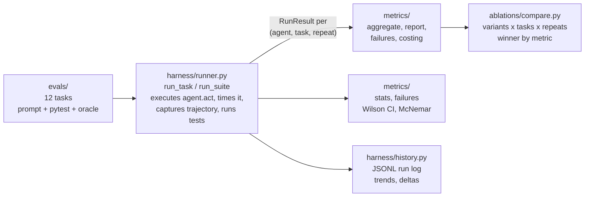

# agent-eval-harness

Eval harness for coding agents. Runs agents against a 12-task suite and measures what actually matters: solve rate, latency, cost, and reliability. Statistical rigor is built in, not bolted on.

Chain-of-thought buys 16.6 points of solve rate for a 57 percent cost increase. That is the kind of sentence this repo exists to produce.

## What it tells you

From `examples/demo.py` (real run, scripted agents):

| variant | solve rate | cost/solve | p50 latency | reliability |
| --- | --- | --- | --- | --- |
| baseline | 66.7% | $63.0000 | 0.43s | 66.7% |
| cot | 83.3% | $99.0000 | 0.51s | 83.3% |

Winner by solve rate: **cot**

From `examples/deep_dive.py` (12 tasks, statistical rigor):

| variant | solve rate | 95% CI | n |
| --- | --- | --- | --- |
| steady | 100.0% | [90.4%, 100.0%] | 36 |
| buggy | 33.3% | [20.2%, 49.7%] | 36 |

discordant pairs: 24/0; chi2=22.04, p=0.0000

The gap is not noise.

## Quickstart

No API keys needed. The demo runs three scripted agents against six coding tasks:

```bash
pip install -e .
python examples/demo.py
```

The deep dive runs the full 12-task suite with confidence intervals, failure analysis, regression history, and cost modeling:

```bash
python examples/deep_dive.py
```

Bring your own agent by implementing the protocol:

```python
from harness import Agent, AgentResult

class MyAgent:
    name = "my-agent"

    def act(self, prompt: str, step_budget: int) -> AgentResult:
        # run your agent loop
        return AgentResult(
            solution=code,
            events=trajectory,
            input_tokens=in_tok,
            output_tokens=out_tok,
        )
```

Then run the suite:

```python
from harness import run_suite
from evals import ALL_TASKS
from metrics import aggregate
from metrics.report import render_suite_table

results = run_suite(MyAgent(), ALL_TASKS, repeats=3)
print(render_suite_table(results))
```

Compare prompt variants head to head:

```python
from ablations import compare, AblationConfig, VARIANTS, PromptVariant

def make_agent(variant: PromptVariant):
    return MyAgent(system_addendum=variant.system_addendum)

report = compare(make_agent, ALL_TASKS, AblationConfig(repeats=3))
print(report.markdown())
print("winner:", report.winner())
```

## Real models

Plug in OpenAI or Anthropic with one import. Optional deps: `pip install openai anthropic`.

```python
from harness.adapters import OpenAIAgent, AnthropicAgent
from harness import run_suite
from evals import EXTENDED_TASKS

agent = OpenAIAgent(model="gpt-4o-mini")  # reads OPENAI_API_KEY
results = run_suite(
    agent, EXTENDED_TASKS, repeats=3,
    price_in_per_1k=agent.price_in_per_1k,
    price_out_per_1k=agent.price_out_per_1k,
)
```

Per-model list prices ship in `harness.adapters.MODEL_PRICES`. Override per instance if your contract differs.

## Key features

**12 coding-agent tasks, graded by pytest.** Six base tasks (fizzbuzz-plus, fix-binary-search, retry-backoff, lru-cache, csv-summary, balanced-parens) and six hard tasks that separate real agents from demos: race conditions, misleading stack traces, recursive schema validation, topological ordering, structural refactors. Every hard task ships with a verified oracle; `tests/test_hard_tasks.py` proves each is solvable and that broken solutions fail.

**Statistical rigor.** Wilson confidence intervals on every solve rate. McNemar's test on paired outcomes to decide whether an ablation gain is real or noise. A sample-size calculator that answers "how many tasks before we trust a 10-point gain" before you pay for the runs.

**Failure taxonomy.** Every failure classified: syntax_error, import_error, name_error, assertion_failure, timeout, agent_crash, no_output. The variant-by-failure-type cross-tab shows which prompt changes fix which failure modes.

**Regression tracking.** Append-only JSONL log of scored runs. Trend tables and run-to-run deltas, so a team sees whether a prompt change helped or hurt across runs instead of trusting one afternoon's numbers.

**Cost modeling.** Projected suite cost across price tiers, plus breakeven analysis: the eval pays for itself if it catches even a small share of bad deploys. Cost per solve is a first-class metric next to solve rate.

**Ablation framework.** Five built-in prompt variants (`baseline`, `cot`, `plan-then-act`, `read-only-first`, `self-critique`), each with a documented hypothesis about what it trades. `compare()` runs every variant over every task N times and names a winner per metric.

## Architecture



The `Agent` protocol is the only integration point. Everything else, tasks, metrics, ablations, is pure Python over `RunResult`.

## Concepts

**Task.** A prompt plus an executable pytest suite. Tests are the judge, not an LLM. A task is solved iff every test passes.

**RunResult.** One agent attempt: solved flag, pytest detail, full pytest output, wall-clock latency, token counts, dollar cost, full event trajectory, and any error. The runner never raises on agent failure; failures are data.

**Metrics.** Solve rate is the headline. `pass@k` answers "does it ever get there." Cost per solve answers "what does a win cost." Reliability answers "does it win every time." Latency p50/p90 answers "how long do users wait."

## Design principles

1. Tests decide. No LLM-as-judge anywhere in the loop.
2. Stdlib only in the core. Adapters are the only optional deps.
3. Deterministic. Scripted agents make CI green without API keys.
4. Cost is a first-class metric. Tokens have prices; the harness does the arithmetic.
5. Failures are data. The runner catches agent exceptions and records them.
6. Uncertainty is reported, not hidden. Every rate ships with an interval.

## Verification

36/36 tests pass. `python -m pytest` from the repo root. The demo and deep-dive examples run end to end with no API keys.

## Roadmap

- Sandboxed execution per task (containers instead of temp dirs)
- Trajectory replay and step-level attribution
- Multi-turn tool-use adapter (planner + executor loop)
- More tasks: repo-scale bug fixes, cross-file refactors

## License

MIT.

---

Built by [Preston Jones](https://github.com/pdj555). Part of a series on agent infrastructure: evals, training data, and failure analysis.
