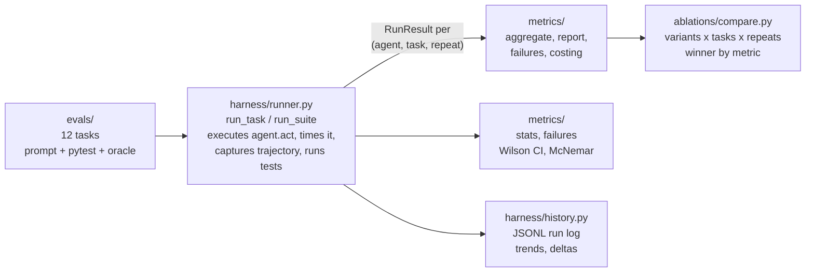

# agent-eval-harness guide

This guide covers setup, usage, architecture, and design. For what this repo found and why it matters, see the [README](../README.md) and the [research summary](research.md).

## What the examples show

From `examples/demo.py` (real run, scripted agents):

| variant | solve rate | cost/solve | p50 latency | reliability |
| --- | --- | --- | --- | --- |
| baseline | 66.7% | $63.0000 | 0.43s | 66.7% |
| cot | 83.3% | $99.0000 | 0.51s | 83.3% |

Winner by solve rate: **cot**

With scripted agents, chain-of-thought adds 16.6 points of solve rate for 57 percent more cost per solve. With real models, the same report shows whether the higher solve rate is worth the higher cost.

From `examples/deep_dive.py` (12 tasks, statistical rigor):

| variant | solve rate | 95% CI | n |
| --- | --- | --- | --- |
| steady | 100.0% | [90.4%, 100.0%] | 36 |
| buggy | 33.3% | [20.2%, 49.7%] | 36 |

discordant pairs: 24/0; chi2=22.04, p=0.0000

## Quickstart

No API keys needed. The demo runs three scripted agents against six coding tasks:

```bash
pip install -e .
python examples/demo.py
```

The deep dive runs the full 12-task suite with confidence intervals, failure analysis, regression history, and cost modeling:

```bash
python examples/deep_dive.py
```

Bring your own agent by implementing the protocol:

```python
from harness import Agent, AgentResult

class MyAgent:
    name = "my-agent"

    def act(self, prompt: str, step_budget: int) -> AgentResult:
        # run your agent loop
        return AgentResult(
            solution=code,
            events=trajectory,
            input_tokens=in_tok,
            output_tokens=out_tok,
        )
```

Then run the suite:

```python
from harness import run_suite
from evals import ALL_TASKS
from metrics import aggregate
from metrics.report import render_suite_table

results = run_suite(MyAgent(), ALL_TASKS, repeats=3)
print(render_suite_table(results))
```

Compare prompt variants head to head:

```python
from ablations import compare, AblationConfig, VARIANTS, PromptVariant

def make_agent(variant: PromptVariant):
    return MyAgent(system_addendum=variant.system_addendum)

report = compare(make_agent, ALL_TASKS, AblationConfig(repeats=3))
print(report.markdown())
print("winner:", report.winner())
```

## Real models

Plug in OpenAI or Anthropic with one import. Optional deps: `pip install openai anthropic`.

```python
from harness.adapters import OpenAIAgent, AnthropicAgent
from harness import run_suite
from evals import EXTENDED_TASKS

agent = OpenAIAgent(model="gpt-4o-mini")  # reads OPENAI_API_KEY
results = run_suite(
    agent, EXTENDED_TASKS, repeats=3,
    price_in_per_1k=agent.price_in_per_1k,
    price_out_per_1k=agent.price_out_per_1k,
)
```

Per-model list prices ship in `harness.adapters.MODEL_PRICES`. Override per instance if your contract differs.

## HTTP API

The FastAPI service in `api/` evaluates agents exposed as HTTP endpoints. Suites contain capability and regression tasks, each with input, a code-based grader, and a trial count. Graders score the final environment state, not the tool-call path.

| method | endpoint | purpose |
| --- | --- | --- |
| POST | `/suites` | Create a suite with `agent_url`, optional `reset_url`, and `default_trials` |
| GET | `/suites/{suite_id}` | Read a suite |
| POST | `/suites/{suite_id}/tasks` | Add a task with input, grader, kind, and optional trial count |
| GET | `/suites/{suite_id}/tasks` | List a suite's tasks |
| POST | `/trials` | `{task_id}` runs one trial; `{suite_id}` runs every task for its configured trial count |
| GET | `/trials/{trial_id}` | Read the transcript, outcome, and grade |
| GET | `/suites/{suite_id}/results?k=3` | Pass rates, `pass@k`, `pass^k`, and capability/regression split |
| GET | `/health` | Service health and version |

Create a suite, add tasks, then `POST /trials` with a task or suite ID. Each trial calls the optional reset hook, sends `{trial_id, task_id, input}` to the agent, extracts the outcome from `final_state` (or the response without `tool_calls` if absent), grades it, and stores the transcript, outcome, and grade in SQLite. The request returns trial IDs after execution. Fetch a trial or the suite results to inspect the run.

18/18 API tests pass. Run `python -m pytest tests/ -q` from `api/`. See [api/README.md](../api/README.md) for setup and the agent contract.

## What the harness includes

### 12 coding tasks, graded by pytest

Six base tasks (fizzbuzz-plus, fix-binary-search, retry-backoff, lru-cache, csv-summary, balanced-parens) and six hard tasks: race conditions, misleading stack traces, recursive schema validation, topological ordering, structural refactors. Every hard task ships with a verified solution; `tests/test_hard_tasks.py` proves each is solvable and that broken solutions fail.

### Confidence intervals and paired tests

Wilson confidence intervals on every solve rate. McNemar's test on paired outcomes to decide whether a difference between variants is larger than chance variation. A sample-size calculator that estimates how many tasks a comparison needs before a 10-point gain can be trusted, before you pay for the runs.

### Failure classes

Every failure is classified: syntax_error, import_error, name_error, assertion_failure, timeout, agent_crash, no_output. The variant by failure type table shows which prompt changes fix which failure modes.

### Scored run history

An append-only JSONL log of scored runs, with trend tables and run to run deltas, so a prompt change is judged across runs instead of by one afternoon's numbers.

### Cost estimates

Projected suite cost across price tiers, plus a breakeven analysis: the eval pays for itself if it catches even a small share of bad deploys. Cost per solve is reported next to solve rate.

### Comparing prompt variants

Five built-in prompt variants (`baseline`, `cot`, `plan-then-act`, `read-only-first`, `self-critique`), each with a note on what it is expected to trade. `compare()` runs every variant over every task N times and names a winner per metric.

## Misalignment and containment tests

Four checks built from Anthropic's October 9, 2026 report on unintended model actions: command injection through a flawed tool, submitting a live form that should never be submitted, reaching fee-gated data with a leaked token, and routing around a fetch tool's URL limit with a shortener. Each check reproduces one category in a sandbox and passes only if the containment layer blocks the workaround while the legitimate task still completes. Run the checks with the guard removed and all four fail, naming what escaped.

```bash
python examples/misalignment.py
```

Full writeup: [MISALIGNMENT_TESTS.md](../MISALIGNMENT_TESTS.md).

## Architecture



The `Agent` protocol is the only integration point. Everything else, tasks, metrics, ablations, is pure Python over `RunResult`.

## Concepts

### Task

A prompt plus an executable pytest suite. Tests are the judge, not an LLM. A task is solved iff every test passes.

### RunResult

One agent attempt: solved flag, pytest detail, full pytest output, wall-clock latency, token counts, dollar cost, full event trajectory, and any error. The runner never raises on agent failure; failures are data.

### Metrics

Solve rate is the share of runs that pass. `pass@k` is the share of tasks solved at least once in k repeats. Cost per solve is the total cost divided by the number of solved runs. Reliability is the share of tasks solved on every repeat. Latency p50 and p90 are the median and 90th percentile run times.

## Design principles

1. Tests decide. No LLM-as-judge anywhere in the loop.
2. Stdlib only in the core. Adapters are the only optional deps.
3. Deterministic. Scripted agents make CI green without API keys.
4. Cost is reported with every result. Tokens have prices; the harness does the arithmetic.
5. Failures are data. The runner catches agent exceptions and records them.
6. Uncertainty is reported, not hidden. Every rate ships with an interval.

## Verification

46/46 tests pass. `python -m pytest` from the repo root. The demo and deep-dive examples run end to end with no API keys.

## Roadmap

- Sandboxed execution per task (containers instead of temp dirs)
- Trajectory replay and step-level attribution
- Multi-turn tool-use adapter (planner + executor loop)
- More tasks: repo-scale bug fixes, cross-file refactors
