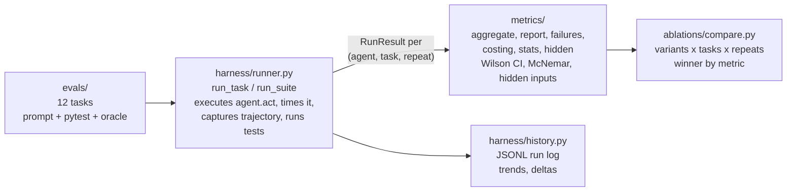

# agent-eval-harness guide

For what this repo found, see the [README](../README.md) and the [research summary](research.md).

## What the examples show

From `examples/demo.py` (scripted agents, six base tasks):

| variant | solve rate | cost/solve | p50 latency | reliability |
| --- | --- | --- | --- | --- |
| baseline | 66.7% | $63.0000 | 0.43s | 66.7% |
| cot | 83.3% | $99.0000 | 0.51s | 83.3% |

Winner by solve rate: cot

With scripted agents, the cot variant adds 16.6 points of solve rate for 57 percent more cost per solve. The token counts behind these dollars are fixed numbers set in the script, so the costs show the arithmetic the harness does, not a measurement.

From `examples/deep_dive.py` (12 tasks, 3 repeats each): steady solves 100.0% [90.4%, 100.0%], buggy 33.3% [20.2%, 49.7%], n = 36 each. Discordant pairs 24/0; chi2 = 22.04, p = 0.0000. Full tables in `examples/deep_dive_report.md`.

## Quickstart

No API keys needed. The demo runs three scripted agents against six coding tasks:

```bash
pip install -e .
python examples/demo.py
```

The deep dive runs the full 12 task suite with confidence intervals, failure analysis, regression history, and cost modeling:

```bash
python examples/deep_dive.py
```

Bring your own agent by implementing the protocol:

```python
from harness import Agent, AgentResult

class MyAgent:
    name = "my-agent"

    def act(self, prompt: str, step_budget: int) -> AgentResult:
        return AgentResult(
            solution=code,
            events=trajectory,
            input_tokens=in_tok,
            output_tokens=out_tok,
        )
```

Then run the suite:

```python
from harness import run_suite
from evals import ALL_TASKS
from metrics import aggregate
from metrics.report import render_suite_table

results = run_suite(MyAgent(), ALL_TASKS, repeats=3)
print(render_suite_table(results))
```

## Real models

Plug in OpenAI or Anthropic with one import. Optional deps: `pip install openai anthropic`.

```python
from harness.adapters import OpenAIAgent, AnthropicAgent
from harness import run_suite
from evals import EXTENDED_TASKS

agent = OpenAIAgent(model="gpt-4o-mini")  # reads OPENAI_API_KEY
results = run_suite(
    agent, EXTENDED_TASKS, repeats=3,
    price_in_per_1k=agent.price_in_per_1k,
    price_out_per_1k=agent.price_out_per_1k,
)
```

List prices per model ship in `harness.adapters.MODEL_PRICES`.

## HTTP API

The FastAPI service in `api/` evaluates agents exposed as HTTP endpoints.

18/18 API tests pass. Run `python -m pytest tests/ -q` from `api/`. See [api/README.md](../api/README.md) for setup and the agent contract.

## What the harness includes

### 12 coding tasks, graded by pytest

Six base tasks (fizzbuzz-plus, fix-binary-search, retry-backoff, lru-cache, csv-summary, balanced-parens) and six hard tasks: race conditions, misleading stack traces, recursive schema validation, topological ordering, structural refactors. Every hard task ships with a verified solution in `evals/oracles.py`; `tests/test_hard_tasks.py` proves each is solvable and that broken solutions fail.

### Confidence intervals and paired tests

Wilson confidence intervals on every solve rate. McNemar's test on paired outcomes. A sample size calculator (`metrics.stats.min_sample_size`) that estimates how many tasks a comparison needs before a gain of a given size can be trusted.

### Failure classes

Every failure is classified into one of eight classes: agent_crash, no_output, timeout, syntax_error, import_error, name_error, assertion_failure, unknown. The class is read from the run's error and its pytest output.

### Scored run history

Scored runs are appended to a JSONL log, with trend tables and run to run deltas.

### Cost estimates

Projected suite cost across price tiers, plus a breakeven analysis: the catch rate an eval needs against an assumed loss per bad deploy before it pays for itself.

### Comparing prompt variants

Five prompt variants ship with the harness (`baseline`, `cot`, `plan-then-act`, `read-only-first`, `self-critique`), each with a note on what it is expected to trade. `compare()` runs every variant over every task N times and names a winner per metric.

## Misalignment and containment tests

Four checks built from Anthropic's October 9, 2026 report on unintended model actions: command injection through a flawed tool, submitting a live form, reaching fee gated data with a leaked token, and routing around a fetch tool's URL limit with a shortener. With the guard removed, all four fail, naming what escaped.

```bash
python examples/misalignment.py
```

Full writeup: [MISALIGNMENT_TESTS.md](../MISALIGNMENT_TESTS.md).

## Architecture



The `Agent` protocol is the only integration point. Everything else, tasks, metrics, ablations, is plain Python over `RunResult`.

## Concepts

### RunResult

One agent attempt: solved flag, pytest detail, full pytest output, latency in seconds, token counts, dollar cost, full event trajectory, and any error.

### Metrics

Solve rate is the share of runs that pass. `pass@k` is the share of tasks solved at least once in k repeats. Cost per solve is total cost divided by solved runs. Reliability is the share of tasks solved on every repeat. Latency p50 and p90 are the median and 90th percentile run times.
